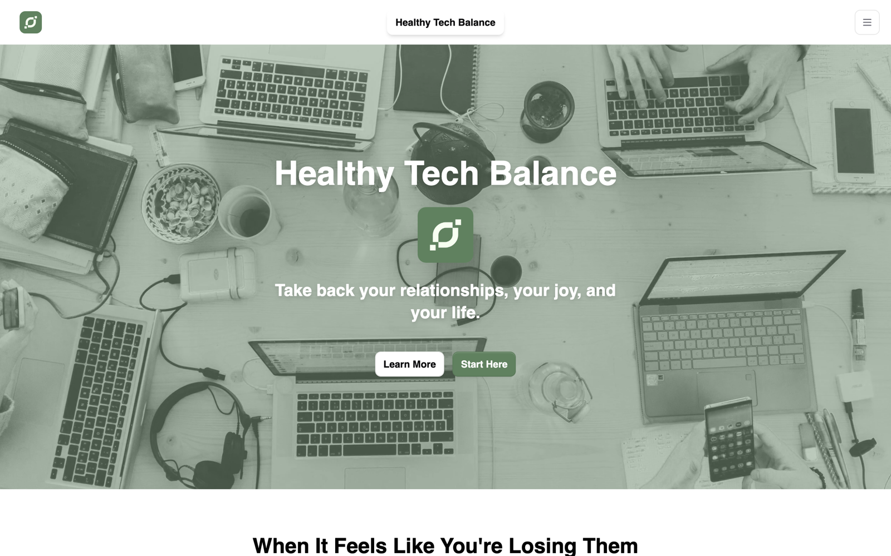
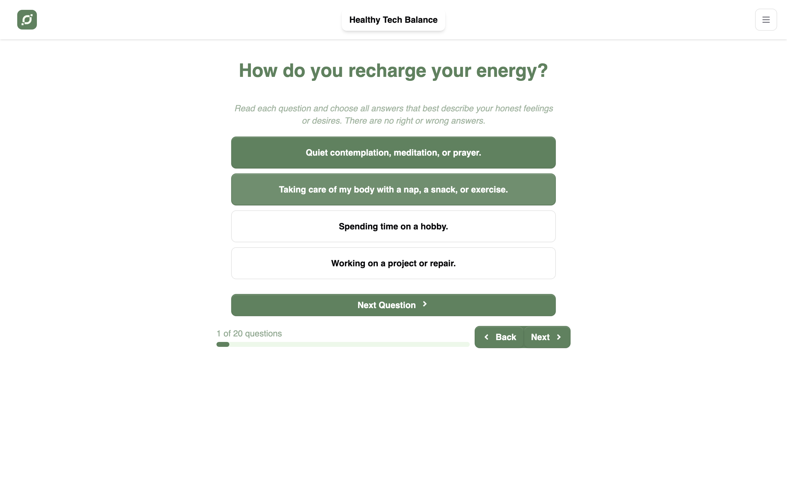
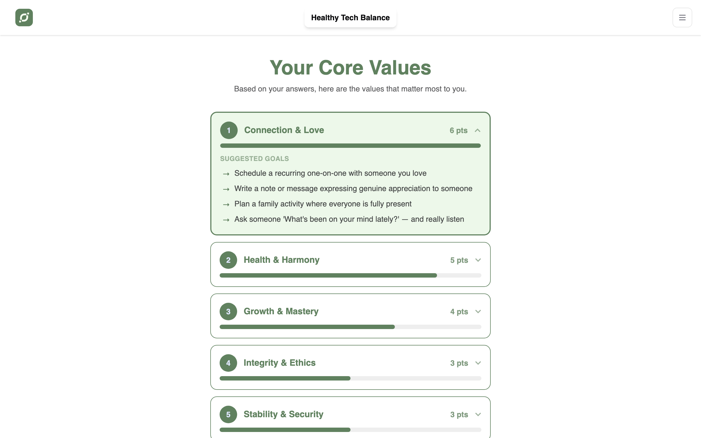

<div align="center">


# Healthy Tech Balance — Core Values Quiz

_A free, no-signup web app that helps families distill their core values and
build a healthier relationship with technology._

[](https://www.healthytechbalance.org)
[](https://vercel.com)
[](https://react.dev)
[](https://www.typescriptlang.org)
[](https://tailwindcss.com)
[](https://vitest.dev)

</div>

---

## Table of Contents

- [Overview](#overview)
- [Live Site](#live-site)
- [Screenshots](#screenshots)
- [Features](#features)
- [Architecture & Engineering](#architecture--engineering)
- [Tech Stack](#tech-stack)
- [Project Structure](#project-structure)
- [Running Locally](#running-locally)

---

## Overview

Healthy Tech Balance is a consulting practice that helps families take back
their relationships, their joy, and their lives from unhealthy technology use.
Its method starts with a simple premise: you can't use tech intentionally until
you know what you actually value. This app is step one of that method — a
20-question **Core Values Quiz** that distills 80 value-tagged answer choices
into a ranked profile of the 10 core values, each paired with concrete,
actionable goals.

The quiz is free, requires no signup, and stores nothing on a server — progress
lives entirely in the browser. It's designed to be taken individually or as a
whole family: a parent and a teenager comparing results is exactly the
conversation the tool exists to start. Alongside the quiz, the site includes a
long-form Learn page explaining the 10 values (each translated into "in tech
terms"), evidence-based screen-time guidelines from WHO/CDC/APA, and a curated
library of 60+ vetted resources — articles, books, podcasts, documentaries, and
organizations.

I designed and built the entire app solo: quiz content model, scoring logic, UI,
test infrastructure, SEO, and deployment.

---

## Live Site

**[healthytechbalance.org](https://www.healthytechbalance.org)**

---

## Screenshots

|                     Home                     |                    Quiz                     |                     Results                     |
| :------------------------------------------: | :-----------------------------------------: | :---------------------------------------------: |
|  |  |  |

---

## Features

**User-facing**

- 20-question quiz, one question per screen, with multi-select answers — every
  option is tagged with one of 10 core value categories
- Live progress bar that counts _answered_ questions, not just position — with
  back/forward navigation that never loses your selections
- Ranked results across the 10 core values with relative score bars; top
  value(s) highlighted
- Every result card expands to reveal 4 concrete suggested goals for that value
  (40 hand-written goals total)
- Download your results as a shareable retina PNG, or print them via a dedicated
  A4 print stylesheet
- Quiz progress survives closing the tab — CTAs across the site switch between
  "Take the quiz" and "Continue the quiz" accordingly
- Long-form Learn page with deep-linkable sections (`/learn#core-values`,
  `/learn#screen-time-guidelines`) and smooth scrolling
- Curated resource library: 24 articles, 12 books, podcasts, documentaries, and
  a dozen-plus organizations for online safety and mental health
- Fully responsive, mobile-first design

**Technical**

- Per-route SEO with zero dependencies — unique `<title>`, meta description,
  canonical link, Open Graph, and Twitter card tags on every page via React 19's
  native metadata hoisting (no `react-helmet`)
- `/results` is `noindex`ed so personal results never land in search engines
- `Organization` + `WebSite` JSON-LD structured data, `sitemap.xml`, and
  `robots.txt`
- Vercel Analytics for traffic monitoring
- SPA routing with Vercel rewrite rules (`vercel.json`)

---

## Architecture & Engineering

**The scoring model.** "Distilling values" is an additive frequency tally over
multi-select answers: 20 questions × 4 value-tagged options yields 80 possible
micro-signals. Each selection scores one point for its value category; results
are ranked descending and bar-normalized against the top score, then each value
is joined to a hand-written set of suggested goals. The content model lives in
two data files (`src/data/questionData.ts`, `src/data/goalsData.ts`), so editing
quiz content never touches component code.

**Client-only state with jotai.** Quiz state is three `atomWithStorage` atoms
(`src/state/state.ts`) persisted to `localStorage`, plus a derived read-only
atom that computes the current question from the index. There is no backend —
refreshing, closing the tab, or coming back days later resumes exactly where you
left off. A versioned migration in `main.tsx` clears stale storage keys when the
question data changes shape between releases, so returning visitors never hit a
crash from old persisted state.

**Real-browser testing, three engines.** Tests run in Vitest's browser mode via
Playwright — real Chromium, Firefox, **and** WebKit, not jsdom. A custom
`renderWithProviders` helper (`src/test/renderWithProviders.tsx`) wraps each
test in a `MemoryRouter` and a fresh jotai store, using `useHydrateAtoms` to
seed quiz state directly instead of clicking through 20 questions. Tests assert
user-facing behavior through accessible roles and names — including scoring
correctness (point totals and DOM ranking order), progress-bar semantics, and
navigation guards like "Next stays disabled until you answer."

**Design tokens, CSS-first.** Styling uses Tailwind CSS 4's `@theme` block to
define a semantic palette (`primary`, `base-100/200/300`, content colors) as
native CSS custom properties — no `tailwind.config.js`. Components come from a
vendored Tailwind Catalyst UI kit built on Headless UI primitives, which
supplies focus management and keyboard navigation for free.

---

## Tech Stack

| Category      | Technology                   | Notes                                   |
| ------------- | ---------------------------- | --------------------------------------- |
| Framework     | React 19 + TypeScript 5.9    | Strict config, native metadata hoisting |
| Build Tool    | Vite 7                       | Path aliasing (`@/`) configured         |
| Styling       | Tailwind CSS 4               | CSS-first `@theme` design tokens        |
| Routing       | React Router 7               | SPA rewrites via `vercel.json`          |
| State         | jotai 2                      | `atomWithStorage` + derived atoms       |
| UI Components | Headless UI 2 + Catalyst kit | Accessible, composable primitives       |
| Image Export  | html-to-image                | Retina PNG download of results          |
| Testing       | Vitest 4 + Playwright        | Browser mode: Chromium, Firefox, WebKit |
| Deployment    | Vercel                       | Auto-deploy from `main` branch          |
| Analytics     | Vercel Analytics 2           | Zero-config traffic tracking            |
| Typography    | Inter variable font          | `@fontsource-variable/inter`            |
| Linting       | ESLint 9 + TypeScript-ESLint | `react-hooks` + `react-refresh` plugins |
| Formatting    | Prettier 3                   |                                         |

---

## Project Structure

```
src/
├── pages/
│   ├── home/                # Hero, method overview, resources teaser, quiz CTA
│   ├── learn/               # The 10 core values, screen-time guidelines, how to start
│   ├── quiz/                # Quiz page shell
│   ├── results/             # Ranked results (noindexed)
│   └── resources/           # Curated library: orgs, articles, books, podcasts, films
├── components/
│   ├── quiz/                # QuizBody, question + answer options, progress footer
│   │   └── results/         # Ranked list, expandable value details
│   ├── navbar/              # Top nav with hamburger dropdown
│   ├── seo/                 # Seo.tsx — per-route title/meta/canonical/OG/JSON-LD
│   └── catalyst-ui-kit/     # Vendored Headless UI component library
├── data/
│   ├── questionData.ts      # 20 questions × 4 value-tagged options
│   ├── goalsData.ts         # 4 suggested goals per value (40 total)
│   └── organizationJsonLd.ts
├── state/state.ts           # jotai atoms, persisted to localStorage
├── test/                    # renderWithProviders (router + hydrated atoms), setup
└── main.tsx                 # Routes, providers, localStorage version migration
public/                      # favicon, sitemap.xml, robots.txt, hero image
docs/screenshots/            # README screenshots
vercel.json                  # SPA rewrite rules
```

---

## Running Locally

```bash
git clone https://github.com/lukeludlow/healthy-tech-values.git
cd healthy-tech-values
npm install
npm run dev
```

Open `http://localhost:5173`. Requires Node 20+. No environment variables
needed.

**Testing** (real browsers via Playwright):

```bash
npm test               # headless run across Chromium, Firefox, and WebKit
npm run test:browser   # watch mode with the Vitest browser UI
npm run lint           # ESLint
npm run build          # typecheck + production build
```
